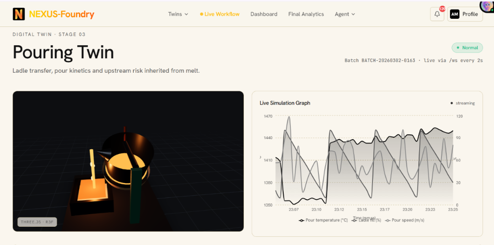
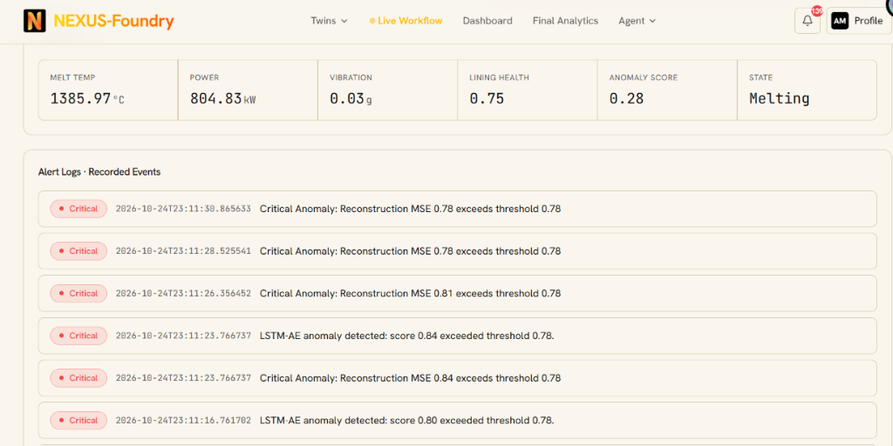

# ⚡ NEXUS-Foundry: Real-Time Multi-Stage Cognitive Digital Twin & AI Optimization Platform

[](https://fastapi.tiangolo.com/)
[](https://react.dev/)
[](https://threejs.org/)
[](https://pytorch.org/)
[](https://tensorflow.org/)
[](https://xgboost.readthedocs.io/)
[](https://www.docker.com/)
[]()

> **A Synchronized Cyber-Physical Digital Twin Platform for High-Temperature Green Foundry Operations**  
> Connecting **Melting $\rightarrow$ Molding $\rightarrow$ Pouring $\rightarrow$ Quality** into an event-driven, closed-loop intelligence system that predicts equipment anomalies in sub-35ms, forecasts thermal degradation 48 hours ahead, and mitigates casting defects before molten metal enters the mold.

---

## 📸 Visual Showcase & Platform Operations

### 1. Operations Overview & Live Cross-Stage Dashboard
The primary command center aggregates live health metrics, anomaly scores, and defect risk estimates across all four digital twins via a sub-50ms WebSocket connection, with a batch lineage timeline color-coded by predicted defect outcome.


---

### 2. Melting Twin: 3D Induction Furnace & Telemetry Streaming
Live 3D interactive Three.js/R3F visualization of the coreless induction melting furnace. Features incandescent color-temperature mapping ($1350^\circ\text{C}$ gold $\rightarrow 1560^\circ\text{C}$ white), live electrical power draw (kW), coil vibration amplitude ($g$), and lining health index.


---

### 3. Pouring Twin: 3D Ladle Kinetics & Mold Pouring Simulation
Virtual replica of the ladle pouring stage displaying real-time tilt kinetics, stream nozzle velocity ($0.8 - 1.6\text{ m/s}$), instantaneous pour temperature, and ladle fill percentage, inheriting upstream thermal degradation warnings from the Melting Twin.



---

### 4. Cross-Stage Live Workflow Execution Pipeline
The automated 11-step audit engine synchronizes cross-stage state handovers. When the LSTM Autoencoder flags an anomaly at the furnace, the system initiates multi-horizon forecasting, validates batch pouring schedules, transfers context to the Pouring Twin, and scores defect risk in real time.


---

### 5. Real-Time Alert Cascade & Anomaly Threshold Diagnostics
High-frequency logging interface displaying real-time alerts. Sensor windows exceeding the LSTM-AE reconstruction error threshold ($\tau = 0.78$) immediately trigger acoustic and visual warnings with millisecond timestamps and full input/output payload traceability.



---

## 🎯 Problem Statement & Industrial Context

Cast iron and steel foundries constitute the manufacturing backbone for automotive, aerospace, and energy infrastructure. Coreless induction melting furnaces and automated high-pressure green sand molding lines operate under extreme thermal conditions:
* **Operating Temperatures:** $1350^\circ\text{C} - 1560^\circ\text{C}$ for gray iron (ASTM A48) and ductile iron (ASTM A536).
* **Power Densities:** $500\text{ kW} - 1500\text{ kW}$ per metric ton of molten metal.
* **Energy Consumption:** $500 - 650\text{ kWh/ton}$. Overheating by just $25^\circ\text{C}$ wastes $15 - 20\text{ kWh/ton}$.

### Core Inefficiencies Solved by NEXUS:
1. **Decoupled Process Silos:** Traditional foundries monitor melting, transport, and pouring as isolated islands. Thermal, chemical, and fluid-dynamic drifts in the furnace are not propagated downstream.
2. **Delayed Laboratory Feedback:** Optical emission spectrometry (OES) takes 15–30 minutes. Chemical fading or silicon depletion is discovered only after hundreds of castings have already solidified with defective microstructure.
3. **High Scrap Rates ($8\% - 15\%$ Baseline):** Misruns, cold shuts, gas porosity, and micro-shrinkage cause significant financial and material losses.
4. **Catastrophic Refractory Wear:** Unmonitored lining erosion ($<25\text{ mm}$ remaining) risks liquid metal breakouts through energized induction coils.
5. **Black-Box Skepticism:** Plant operators mistrust raw machine learning predictions without transparent physical rationales.

---

## 🏗️ System Architecture

NEXUS-Foundry is architected as a **7-Layer Cyber-Physical System of Systems**:

```
┌──────────────────────────────────────────────────────────────────────────────────┐
│                                APPLICATION LAYER                                 │
│  React 18 Dashboard • Three.js 3D Twins • SHAP Waterfalls • Real-Time Alert Logs │
├──────────────────────────────────────────────────────────────────────────────────┤
│                               INTELLIGENCE LAYER                                 │
│  TreeSHAP Fast Attributions • RAG Cognitive Assistant (Llama 3 + ChromaDB)       │
├──────────────────────────────────────────────────────────────────────────────────┤
│                               AI / ANALYTICS LAYER                               │
│  LSTM-AE (Anomaly) • TFT (Degradation) • XGBoost (Defects) • PINN (Physics)      │
├──────────────────────────────────────────────────────────────────────────────────┤
│                               DIGITAL TWIN LAYER                                 │
│  Melting Twin (Furnace) ──> Molding Twin (Sand) ──> Pouring Twin ──> Quality Twin│
├──────────────────────────────────────────────────────────────────────────────────┤
│                                DATA STORAGE LAYER                                │
│  InfluxDB (Time-Series) • PostgreSQL (Lineage) • Redis (State) • File Storage    │
├──────────────────────────────────────────────────────────────────────────────────┤
│                                 INGESTION LAYER                                  │
│  FastAPI Async Gateway • WebSocket Broadcast (2 Hz) • MQTT Broker • Kafka Bridge │
├──────────────────────────────────────────────────────────────────────────────────┤
│                                  PHYSICAL / EDGE                                 │
│  Optical Pyrometers • Accelerometers • Power CTs • High-Resolution Line Cameras  │
└──────────────────────────────────────────────────────────────────────────────────┘
```

---

## 🧩 The Four Stateful Digital Twins

Each digital twin is an independent, stateful service owning its domain models, telemetry buffers, and state transition machine:

| Digital Twin | Physical Component | Key State Variables | AI Models & Analytical Tasks |
| :--- | :--- | :--- | :--- |
| **Melting Twin** | Coreless Induction Melting Furnace | `melt_temp`, `power_kw`, `vibration_g`, `lining_health`, `operating_state` | Evaluates **LSTM-AE** every 2s; triggers **TFT** multi-horizon degradation forecasts on threshold crossings. |
| **Molding Twin** | High-Pressure Green Sand Line | `sand_moisture`, `permeability`, `green_strength`, `compactability`, `mold_age` | Tracks sand conditioning parameters; supplies batch-specific molding features downstream to Pouring Twin. |
| **Pouring Twin** | Transport Ladle & Bottom-Pour Gating | `pour_temp`, `pour_speed`, `ladle_fill_pct`, `upstream_risk`, `pre_pour_risk` | Computes ladle heat loss ($\Delta T_{\text{drop}}$); executes **XGBoost + TreeSHAP** pre-pour risk evaluation; validates thermal bounds via **PINN**. |
| **Quality Twin** | Post-Pour Shakeout & Visual QC | `defect_prediction`, `defect_type`, `severity`, `inspection_result` | Records visual inspection metadata; executes **ResNet-50** surface defect categorization; feeds automated continuous retraining queue. |

---

## 🤖 4-Tier Hybrid AI/ML Suite

The platform deploys a specialized multi-model architecture where each model addresses a distinct physical, temporal, or spatial requirement:

```
┌───────────────────────────────────────────────────────────────────────────────────┐
│                          4-TIER HYBRID AI/ML PIPELINE                             │
├─────────────────────┬─────────────────────┬─────────────────────┬─────────────────┤
│ Tier 1: Screening   │ Tier 2: Forecasting │ Tier 3: Risk Class. │ Tier 4: Explain │
│ LSTM-Autoencoder    │ Temporal Fusion Tr. │ XGBoost Classifier  │ TreeSHAP Engine │
│ Score > 0.78 Alert  │ P10, P50, P90 Bands │ Multi-Class Defect  │ <10ms Waterfall │
└─────────────────────┴─────────────────────┴─────────────────────┴─────────────────┘
```

### 1. LSTM Autoencoder (LSTM-AE) — Temporal Anomaly Detection
* **Role:** Real-time unsupervised anomaly detection on high-frequency furnace telemetry.
* **Architecture:** $\text{Input}(10 \times 6) \rightarrow \text{LSTM}(64) \rightarrow \text{Dropout}(0.2) \rightarrow \text{LSTM}(32) \rightarrow \mathbf{z} \in \mathbb{R}^{32} \rightarrow \text{Repeat}(10) \rightarrow \text{LSTM}(32) \rightarrow \text{LSTM}(64) \rightarrow \text{Dense}(6)$.
* **Mathematical Loss:** Mean Squared Error (MSE) between sliding input $\mathbf{X}$ and reconstructed sequence $\hat{\mathbf{X}}$:
  $$\mathcal{L}_{\text{MSE}}(\mathbf{X}, \hat{\mathbf{X}}) = \frac{1}{T \cdot D} \sum_{t=1}^{T} \sum_{d=1}^{D} (x_{t,d} - \hat{x}_{t,d})^2$$
* **Threshold Decision:** Triggers `CRITICAL ALERT` when ratio-normalized score exceeds $\tau = 0.78$.
* **Benchmark:** **$99.6\%$ Detection Rate**, $99.4\%$ F1-score, $<35\text{ ms}$ inference latency.

### 2. Temporal Fusion Transformer (TFT) — Multi-Horizon Forecasting
* **Role:** 48-hour projected degradation and 15-minute melt temperature trajectory forecasting.
* **Mechanisms:** Variable Selection Networks (VSN), Gated Residual Networks (GRN), and Multi-Head Temporal Self-Attention.
* **Loss Function:** Multi-quantile pinball loss for $q \in \{0.1, 0.5, 0.9\}$:
  $$\mathcal{L}_q(y, \hat{y}_q) = \max\Big(q(y - \hat{y}_q), (1-q)(\hat{y}_q - y)\Big)$$
* **Benchmark:** **$R^2 = 0.982$**, $\text{MAE} = 12.4^\circ\text{C}$, $\text{RMSE} = 19.3^\circ\text{C}$.

### 3. XGBoost Classifier — Pre-Pour Casting Defect Risk Scoring
* **Role:** Predicts probability of Misrun, Gas Porosity, Micro-Shrinkage, and Chill defects prior to pouring.
* **Features:** 65-dimensional vector combining process parameters, chemical spectrometry ($\text{CE} = \%\text{C} + \frac{\%\text{Si} + \%\text{P}}{3}$), inoculation fade time, and 3D geometry embeddings.
* **Benchmark:** **$\text{ROC-AUC} = 0.968$**, Precision $94.2\%$, Recall $93.7\%$, $<5\text{ ms}$ latency.

### 4. TreeSHAP — Real-Time Game-Theoretic Explainability
* **Role:** Decomposes exact feature contributions for every XGBoost prediction into an operator waterfall plot.
* **Efficiency:** Polynomial tree-path traversal $\mathcal{O}(T L D^2)$ executing in **$<10\text{ ms}$** on live streaming threads:
  $$f(x) = \phi_0 + \sum_{i=1}^{M} \phi_i(x), \quad \text{where } \phi_0 = \mathbb{E}[f(x)] = 0.082$$

### 5. Physics-Informed Neural Network (PINN) — Thermodynamic Simulation
* **Role:** What-if parameter exploration enforcing 2D transient thermal conduction (Fourier's Law):
  $$\frac{\partial T}{\partial t} = \alpha \nabla^2 T, \quad \mathcal{L} = \mathcal{L}_{\text{data}} + 10.0 \cdot \mathcal{L}_{\text{PDE}}$$
* **Benchmark:** Temperature error $<5.0^\circ\text{C}$, simulation runtime $<25\text{ ms}$.

### 6. ResNet-50 — Visual Surface Inspection
* **Role:** Deep residual convolutional feature extraction for post-pour casting defect inspection (hot tears, macro-porosity, sand inclusions).
* **Benchmark:** $91.2\%$ accuracy (Phase 2), $<120\text{ ms}$ inference.

---

## ⚡ 11-Step Cross-Stage Handover Pipeline

When an operational anomaly occurs at the furnace, the cross-stage coordination engine enforces an automated 11-step audit trail:

```
  1. LSTM-AE detects furnace sensor anomaly (reconstruction error > 0.78)
  2. Melting Twin triggers TFT multi-horizon degradation model
  3. TFT returns 48-hour P10 / P50 / P90 quantile forecasts
  4. Melting Twin verifies scheduled pour window for active batch_id
  5. Melting Twin dispatches cross-stage warning to Pouring Twin (< 2 seconds)
  6. Pouring Twin receives warning and inherits upstream thermal deficit
  7. Query batch-matched sand condition features from Molding Twin
  8. Query part-linked 3D geometry shape embeddings
  9. Assemble standardized 65-feature vector
 10. Execute XGBoost multi-defect classifier and TreeSHAP attribution
 11. Prescribe corrective action (kW power trim, FeSi addition, ladle preheat)
```

---

## 🚀 Quick Start with Docker

### Prerequisites
* [Docker Desktop](https://www.docker.com/products/docker-desktop/) with Compose v2 enabled.
* Minimum **8 GB RAM** allocated to Docker.

### 1. Clone & Run Stack
```bash
git clone https://github.com/NEXUSFoundry-Your-Foundry-Optimizer/phase_2_dynamic.git
cd phase_2_dynamic

# Build and start all services (Backend, Frontend, InfluxDB, Postgres, Redis, Kafka, MQTT, Grafana)
docker compose up --build
```

### 2. Access Local Endpoints
| Component | Local URL | Description |
| :--- | :--- | :--- |
| **Frontend Web App** | [`http://localhost:8081`](http://localhost:8081) | Operator Dashboard & 3D Twins |
| **FastAPI Backend Docs** | [`http://localhost:8000/docs`](http://localhost:8000/docs) | Interactive Swagger / OpenAPI Spec |
| **Service Health Check** | [`http://localhost:8000/api/health`](http://localhost:8000/api/health) | Backend & Model Service Status |
| **InfluxDB UI** | [`http://localhost:8086`](http://localhost:8086) | Time-Series Telemetry Explorer |
| **Grafana** | [`http://localhost:3000`](http://localhost:3000) | Observability & Metrics Dashboards |

To stop the stack:
```bash
docker compose down
```

---

## 💻 Local Development Setup

To run services locally outside Docker containers with hot reloading:

### Backend Setup
```bash
# Create and activate Python virtual environment
python -m venv .venv
# On Windows PowerShell:
.\.venv\Scripts\Activate.ps1
# On Linux/macOS:
# source .venv/bin/activate

# Install dependencies
pip install -r backend/requirements.txt

# Run FastAPI backend with Uvicorn
$env:PYTHONPATH = (Get-Location).Path
uvicorn backend.app.main:app --reload --host 0.0.0.0 --port 8000
```

### Frontend Setup
```bash
cd frontend
npm ci
$env:VITE_API_URL = "http://localhost:8000"
npm run dev
```
Open [`http://localhost:5173`](http://localhost:5173) in your browser.

---

## 📁 Repository Directory Layout

```
.
├── backend/                         # FastAPI core backend service
│   ├── app/
│   │   ├── api/v1/                  # REST & WebSocket API endpoints
│   │   ├── digital_twins/           # Melting, Molding, Pouring, Quality twins
│   │   ├── ml/                      # LSTM-AE, TFT, XGBoost, SHAP, PINN, ResNet
│   │   ├── simulator/               # Dataset replay & MQTT event streaming
│   │   ├── db/                      # PostgreSQL, InfluxDB, Redis clients
│   │   ├── kafka/                   # Kafka event bus producer/consumer/bridge
│   │   └── workflows/               # 11-step cross-stage workflow store
│   ├── models/                      # XGBoost & SHAP serialized artifacts
│   └── requirements.txt             # Python backend dependencies
├── frontend/                        # React 18 + Vite + TailwindCSS application
│   ├── src/
│   │   ├── routes/                  # TanStack Router pages (Dashboard, Twins, Agent)
│   │   ├── store/                   # Zustand state management
│   │   └── lib/                     # Live API & WebSocket subscribers
│   └── package.json
├── Datasets/                        # Validated industrial synthetic datasets
│   ├── furnace_sensor.csv           # 739k rows induction furnace telemetry
│   ├── pouring_stream.csv           # Ladle & pour kinetics records
│   ├── chemical_spectrometry.csv    # C, Si, Mn, Mg, CE chemistry records
│   └── inoculation_quality.csv      # FeSi inoculation & fade curves
├── diagrams/                        # High-resolution architectural schematics
├── docs/screenshots/               # Platform operation screenshots
├── models/                          # Serialized deep learning weights (.h5, .pt)
│   ├── lstm/                        # LSTM-AE weights (lstm_ae_best.h5)
│   ├── tft/                         # PyTorch TFT model (tft_model.pt)
│   └── pinn/                        # PyTorch PINN model (pinn_heat_equation.pt)
├── docker-compose.yml               # Multi-container orchestration definition
├── generate_datasets.py             # Thermodynamic data generation engine
├── train_and_export_models.py       # Model training & artifact export pipeline
└── README.md                        # Master platform documentation
```

---

## 📊 Summary of Calibrated Datasets

All synthetic datasets are calibrated against empirical pyrometallurgical standards (**AFS Iron Casting Handbook**, **ASTM A48 / A536**, and **ASM Handbook Vol. 15**):

| Dataset File | Records | Core Process Telemetry | Thermodynamic Standard Applied |
| :--- | :--- | :--- | :--- |
| `furnace_sensor.csv` | 739,914 | Melt temp, Power kW, Vibration, Lining health, Cooling water $\Delta T$ | Inductotherm induction coil power curves; $1350-1560^\circ\text{C}$. |
| `ladle_telemetry.csv` | 10,000 | Preheat temp, Shell temp, Transit duration, Heat loss rate ($^\circ\text{C/min}$) | Stefan-Boltzmann radiation ($\epsilon = 0.85$) + Fourier conduction. |
| `pouring_stream.csv` | 10,000 | Pour temp, Nozzle velocity, Mold fill time, Gating ratio, Defect tags | Reynolds number turbulent flow limit ($v_{\text{pour}} \le 1.4\text{ m/s}$). |
| `chemical_spectrometry.csv` | 5,000 | C%, Si%, Mn%, S%, P%, Residual Mg%, Carbon Equivalent (CE) | ASTM A536 Ductile iron nodularity bounds ($\text{CE} = 4.0 - 4.6\%$). |
| `inoculation_quality.csv` | 5,000 | FeSi wt%, Fade duration, Nodularity %, Chill depth (mm) | AFS Inoculation fade decay kinetics ($N(t) = N_0 e^{-k_{\text{fade}} t}$). |
| `energy_tariffs.csv` | 8,760 | Hourly Time-of-Use (TOU) rates, Peak demand charges ($\$/\text{kW}$) | Industrial electrical grid demand curves for smart scheduling. |

---


## 👥 Related Repositories

* **Backend Engine:** [`https://github.com/NEXUSFoundry-Your-Foundry-Optimizer/backend.git`](https://github.com/NEXUSFoundry-Your-Foundry-Optimizer/backend.git)
* **Full-Stack Dynamic Platform:** [`https://github.com/NEXUSFoundry-Your-Foundry-Optimizer/phase_2_dynamic.git`](https://github.com/NEXUSFoundry-Your-Foundry-Optimizer/phase_2_dynamic.git)

---

## 📄 License & Attribution

Designed and developed for **Project NEXUS (Phase 2 Milestone)**. All rights reserved. Built with pride for advanced manufacturing, sustainable metallurgy, and industrial artificial intelligence.
