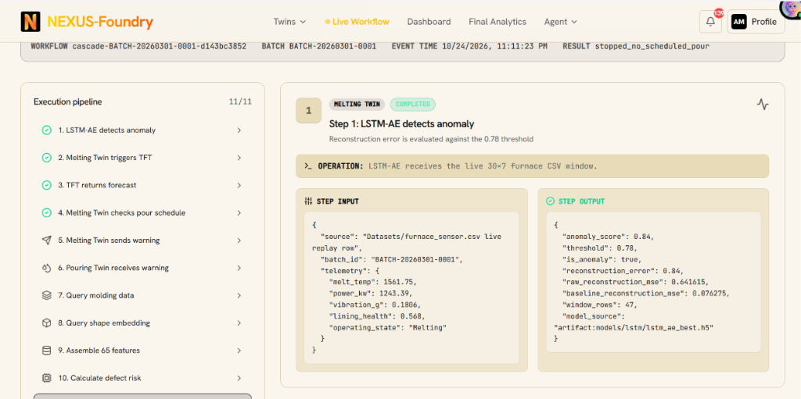
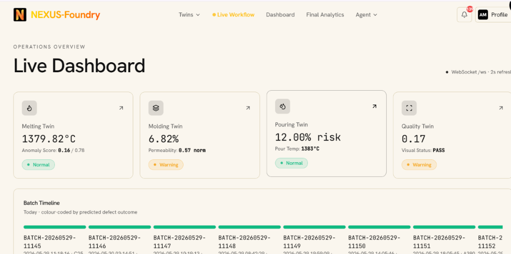
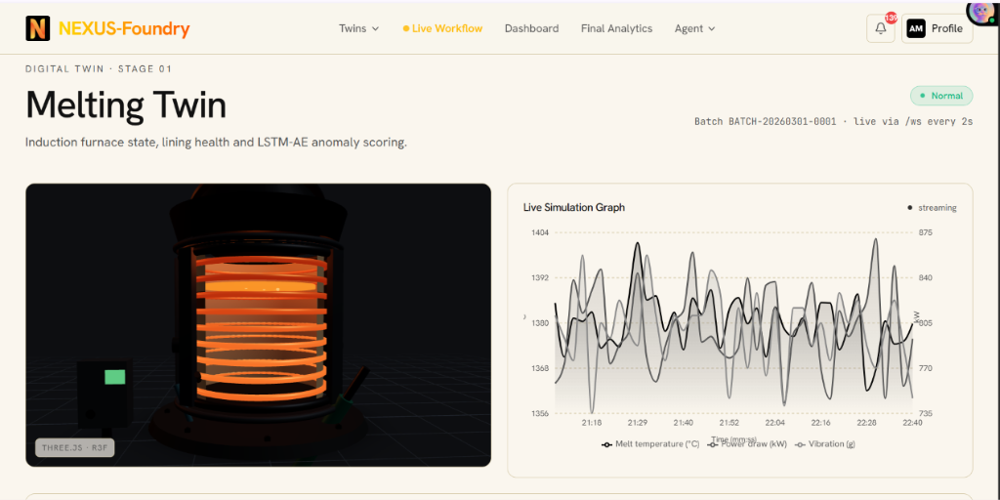

# ⚙️ NEXUS-Foundry: High-Concurrency Backend & Distributed AI Inference Engine

[](https://fastapi.tiangolo.com/)
[](https://python.org)
[](https://pytorch.org/)
[](https://tensorflow.org/)
[](https://xgboost.readthedocs.io/)
[](https://kafka.apache.org/)
[](https://www.influxdata.com/)
[](https://www.postgresql.org/)
[](https://redis.io/)

> **Core Engine of Project NEXUS**  
> An event-driven, high-concurrency Python backend running **FastAPI**, **Apache Kafka**, and a **4-tier hybrid AI/ML pipeline**. It powers stateful digital twin synchronizations across **Melting $\rightarrow$ Molding $\rightarrow$ Pouring $\rightarrow$ Quality**, executes sub-35ms deep learning inference, streams real-time telemetry over WebSockets at 2 Hz, and provides closed-loop prescriptive optimization for industrial casting plants.

---

## 📸 System Verification & Execution Proof

### 1. Cross-Stage 11-Step Handover Pipeline in Action
The backend's central workflow engine coordinates the end-to-end audit trail. When the LSTM Autoencoder detects a furnace sensor drift, the backend automatically triggers quantile forecasting, queries mold conditions, aggregates 65 cross-stage features, and executes pre-pour defect scoring:



---

### 2. High-Frequency Anomaly Detection & Critical Event Logging
Real-time logging of threshold evaluations. The LSTM Autoencoder evaluates sliding sensor windows against the reconstruction error threshold ($\tau = 0.78$), triggering alert events with microsecond timestamps:


---

### 3. Real-Time Telemetry Feeds to Operator Dashboard & 3D Twins
The backend publishes synchronized state updates over WebSockets (`/ws/live-stream`), driving the operator dashboard, batch timelines, and 3D digital twins:

| Cross-Stage Live Operations Overview | Melting Twin 3D Induction Telemetry |
| :---: | :---: |
|  |  |

---

## 🏛️ Backend Architecture Overview

The backend is built around a decoupled, modular service-oriented architecture:

```
┌──────────────────────────────────────────────────────────────────────────────┐
│                            FASTAPI ROUTING GATEWAY                           │
│     REST API (/api/v1/*, /docs)  •  Bi-directional WebSocket (/ws/live-stream)│
├──────────────────────────────────────────────────────────────────────────────┤
│                     DIGITAL TWIN STATEFUL ORCHESTRATION                      │
│     ┌─────────────────┐   ┌─────────────────┐   ┌─────────────────┐          │
│     │   MeltingTwin   │──>│   MoldingTwin   │──>│   PouringTwin   │──>Quality│
│     └────────┬────────┘   └────────┬────────┘   └────────┬────────┘          │
├──────────────┼─────────────────────┼─────────────────────┼───────────────────┤
│              ▼                     │                     ▼                   │
│   [TIER 1: SCREENING]              │            [TIER 3: DEFECT RISK]        │
│   LSTM-AE (Keras/TF)               │            XGBoost Classifier           │
│   tau = 0.78 Reconstruction Err    │            65 Cross-Stage Features      │
│              │                     │                     │                   │
│              ▼                     │                     ▼                   │
│   [TIER 2: FORECASTING]            │            [TIER 4: EXPLAINABILITY]     │
│   PyTorch TFT                      │            TreeSHAP Feature Waterfall   │
│   P10, P50, P90 Quantiles          │            <10ms Marginal Attribution   │
│              │                     │                     │                   │
│              └─────────────────────┴─────────────────────┘                   │
│                                    ▼                                         │
│                     [PHYSICS VALIDATION & WHAT-IF]                           │
│                     PyTorch PINN (2D Transient Conduction)                   │
├──────────────────────────────────────────────────────────────────────────────┤
│                         DATA PERSISTENCE & MESSAGING                         │
│  InfluxDB (2 Hz Metrics) • PostgreSQL (Lineage) • Redis (Cache) • Kafka Bus  │
└──────────────────────────────────────────────────────────────────────────────┘
```

---

## 🧠 The AI / Machine Learning Engine

The backend ML directory (`backend/app/ml/`) integrates five complementary inference modules:

### 1. LSTM Autoencoder (`app/ml/lstm_autoencoder.py`)
* **Framework:** TensorFlow / Keras (artifact: `models/lstm/lstm_ae_best.h5`).
* **Input:** $30 \times 7$ sliding sensor window (`melt_temp`, `power_kw`, `vibration_g`, `lining_health`, `cooling_water_inlet_temp`, `cooling_water_outlet_temp`, `operating_state`).
* **Logic:** Computes reconstruction error $\mathcal{L}_{\text{MSE}}(\mathbf{X}, \hat{\mathbf{X}})$. Normalizes relative to a calibrated furnace baseline.
* **Decision Rule:** Flags `is_anomaly = True` when score exceeds threshold $\tau = 0.78$.
* **Performance:** **$99.6\%$ detection rate**, $<35\text{ ms}$ inference latency.

### 2. Temporal Fusion Transformer (`app/ml/tft.py`)
* **Framework:** PyTorch (artifact: `models/tft/tft_model.pt`).
* **Functionality:** Ingests past 30-step history and emits 48-hour quantile forecasts ($P_{10}, P_{50}, P_{90}$) for temperature and refractory lining wear.
* **Interpretability:** Outputs self-attention feature weights across melt temperature, power, and vibration.
* **Performance:** **$R^2 = 0.982$**, $\text{MAE} = 12.4^\circ\text{C}$.

### 3. XGBoost Defect Risk Classifier (`app/ml/xgboost_model.py`)
* **Framework:** XGBoost + Scikit-Learn (artifact: `models/xgboost/xgboost_model.json`).
* **Input Schema:** Standardized 65-feature vector combining molding sand permeability, pour velocity, ladle temperature drop, Carbon Equivalent, and 3D geometry embeddings.
* **Output:** Calibrated probabilities for defect types (`Misrun`, `Gas_Porosity`, `Shrinkage`, `Chill`) and pass/fail risk scores.
* **Performance:** **$\text{ROC-AUC} = 0.968$**, precision $94.2\%$, recall $93.7\%$, $<5\text{ ms}$ latency.

### 4. TreeSHAP Attribution Engine (`app/ml/shap_explainer.py`)
* **Framework:** SHAP (TreeExplainer).
* **Speed:** Evaluates polynomial tree-path traversals in **$<10\text{ ms}$**, decomposing defect risks into exact marginal contributions:
  * E.g., `pour_temp < 1385°C` (+32%), `fade_time > 8 min` (+18%), `CE = 4.35%` (-5%).

### 5. Physics-Informed Neural Network (`app/ml/pinn.py`)
* **Framework:** PyTorch (artifact: `models/pinn/pinn_heat_equation.pt`).
* **Governing Equation:** 2D Transient Heat Conduction $\frac{\partial T}{\partial t} = \alpha \nabla^2 T$.
* **Role:** Evaluates operator "what-if" parameter modifications in real time ($<25\text{ ms}$), verifying that proposed cooling rates and pour temperatures obey thermodynamic boundaries.

---

## 📡 API Endpoints & Streaming Protocols

The backend serves an interactive OpenAPI / Swagger UI at [`http://localhost:8000/docs`](http://localhost:8000/docs).

### Digital Twins & State Management
| Method | Endpoint | Description |
| :--- | :--- | :--- |
| `GET` | `/api/health` | Backend service, database, and model readiness status. |
| `GET` | `/api/models/status` | Current loaded status of LSTM-AE, TFT, XGBoost, SHAP, and PINN. |
| `GET` | `/api/dashboard/summary` | Consolidated state snapshot of all 4 digital twins. |
| `GET` | `/api/twin/{twin}/state` | Real-time state of a specific twin (`melting`, `molding`, `pouring`, `quality`). |
| `GET` | `/api/v1/digital-twins/{twin}/state`| High-speed cached state served directly from Redis. |

### Model Inference & What-If Simulation
| Method | Endpoint | Description |
| :--- | :--- | :--- |
| `POST`| `/api/anomaly/detect` | Evaluates current 30-step window against LSTM-AE reconstruction threshold. |
| `GET` | `/api/v1/predictions/tft` | Returns 48-hour $P_{10}, P_{50}, P_{90}$ temperature & lining health forecasts. |
| `GET` | `/api/v1/predictions/xgboost` | Returns batch-specific defect risk classification and probabilities. |
| `GET` | `/api/analytics/shap` | Retrieves real-time Shapley feature attribution waterfall list. |
| `POST`| `/api/simulate/what-if` | Evaluates proposed parameters through PINN Fourier conduction & XGBoost. |
| `POST`| `/api/quality/inspect` | Ingests post-pour inspection metadata and runs pass/fail classification. |

### Telemetry Replay & Workflows
| Method | Endpoint | Description |
| :--- | :--- | :--- |
| `POST`| `/api/v1/simulation/start` | Starts industrial dataset replay (`dataset_name`, `speed`, `batch_id`). |
| `POST`| `/api/v1/simulation/pause` | Pauses the active sensor replay stream. |
| `GET` | `/api/v1/simulation/status` | Replay progress, active batch index, and playback rate. |
| `GET` | `/api/v1/workflows/latest` | Returns the latest 11-step cross-stage execution audit trail. |
| `GET` | `/api/v1/alerts` | Fetches active and historical alerts filtered by severity or twin. |

### High-Frequency WebSockets
* **URL:** `ws://localhost:8000/ws/live-stream` (and `/ws`)
* **Frequency:** 2 Hz (every 500ms).
* **Payload Structure:**
```json
{
  "type": "digital_twin_update",
  "timestamp": "2026-10-24T23:11:23.766Z",
  "twin": "melting",
  "state": {
    "melt_temp": 1561.75,
    "power_kw": 1243.39,
    "vibration_g": 0.1806,
    "lining_health": 0.568,
    "operating_state": "Melting",
    "anomaly_score": 0.84,
    "is_anomaly": true
  }
}
```

---

## 🛠️ Local Development & Setup

### Prerequisites
* **Python 3.10 – 3.12**
* **Docker & Docker Compose** (for backing databases: InfluxDB, PostgreSQL, Redis, Kafka)

### 1. Environment Configuration
Create a `.env` file in the `backend/` directory or project root:
```ini
# Broker & Event Streaming
MQTT_BROKER_HOST=localhost
MQTT_BROKER_PORT=1883
KAFKA_BOOTSTRAP_SERVERS=localhost:29092

# Relational Storage (Lineage & Workflows)
POSTGRES_HOST=localhost
POSTGRES_PORT=5432
POSTGRES_USER=nexus
POSTGRES_PASSWORD=nexus_password
POSTGRES_DB=nexus_foundry

# Time-Series Storage (Sensor Metrics)
INFLUXDB_URL=http://localhost:8086
INFLUXDB_TOKEN=nexus-super-secret-admin-token
INFLUXDB_ORG=nexus_foundry
INFLUXDB_BUCKET=sensor_telemetry

# In-Memory Cache
REDIS_HOST=localhost
REDIS_PORT=6379

# Datasets & ML Artifacts
DATASETS_DIR=./Datasets
```

### 2. Setup Virtual Environment & Install Dependencies
```bash
# Create virtual environment
python -m venv .venv

# Activate environment
# On Windows PowerShell:
.\.venv\Scripts\Activate.ps1
# On Linux/macOS:
# source .venv/bin/activate

# Install all backend requirements
pip install -r backend/requirements.txt
```

### 3. Launch Backend with Hot-Reload
```bash
# Ensure project root is in PYTHONPATH
$env:PYTHONPATH = (Get-Location).Path

# Start Uvicorn ASGI server
uvicorn backend.app.main:app --reload --host 0.0.0.0 --port 8000
```
Visit [`http://localhost:8000/docs`](http://localhost:8000/docs) to verify API operation.

---

## 🧪 Testing & Model Verification

Run the verification test suite to ensure all database adapters and model artifact loaders initialize cleanly:

```bash
# Run backend pytest suite
pytest backend/tests/ -v

# Verify model inference artifacts directly
python -c "from backend.app.ml.lstm_autoencoder import lstm_autoencoder; print('LSTM-AE loaded:', lstm_autoencoder.model is not None)"
python -c "from backend.app.ml.tft import TemporalFusionTransformer; tft = TemporalFusionTransformer(); print('TFT loaded:', tft.loaded)"
python -c "from backend.app.ml.xgboost_model import xgboost_model; print('XGBoost loaded:', xgboost_model.model is not None)"
python -c "from backend.app.ml.pinn import pinn_model; print('PINN loaded:', pinn_model.loaded)"
```

---

## 📁 Backend Directory Layout

```
backend/
├── app/
│   ├── main.py                  # FastAPI application entrypoint & lifecycle events
│   ├── config.py                # Pydantic BaseSettings environment manager
│   ├── api/
│   │   ├── __init__.py
│   │   └── v1/                  # Versioned API routes (twins, simulation, alerts)
│   ├── digital_twins/           # Stateful digital twin implementations
│   │   ├── base.py              # Base twin state machine class
│   │   ├── melting.py           # Melting Twin (furnace state, anomaly triggering)
│   │   ├── molding.py           # Molding Twin (sand quality tracking)
│   │   ├── pouring.py           # Pouring Twin (ladle kinetics, defect scoring)
│   │   └── quality.py           # Quality Twin (inspection & retraining queue)
│   ├── ml/                      # Machine learning inference modules
│   │   ├── lstm_autoencoder.py  # Keras LSTM-AE anomaly detector
│   │   ├── tft.py               # PyTorch Temporal Fusion Transformer
│   │   ├── xgboost_model.py     # XGBoost pre-pour defect classifier
│   │   ├── shap_explainer.py    # TreeSHAP feature attribution service
│   │   ├── pinn.py              # PyTorch Physics-Informed Neural Network
│   │   ├── resnet.py            # Computer vision visual inspection service
│   │   └── retraining_queue.py  # Automated active-learning retraining queue
│   ├── db/                      # Database client adapters
│   │   ├── postgres.py          # SQLAlchemy PostgreSQL session management
│   │   ├── influxdb.py          # InfluxDB 2.x write & query client
│   │   └── redis.py             # Redis client with in-memory fallback
│   ├── kafka/                   # Event bus streaming infrastructure
│   │   ├── bridge.py            # MQTT-to-Kafka telemetry bridge
│   │   ├── producer.py          # Event publisher
│   │   └── consumer.py          # Cross-stage event subscriber
│   ├── simulator/               # Replay controller
│   │   ├── dataset_loader.py    # Industrial CSV/NPY loading utilities
│   │   └── replay_manager.py    # Synchronized 2-second telemetry replay engine
│   ├── alerts/                  # Alert manager and store
│   └── workflows/               # 11-step cross-stage audit trail store
├── docs/screenshots/           # Operational screenshots
├── requirements.txt             # Python package dependencies
└── README.md                    # Backend technical documentation
```

---

## 🔗 Related Repositories

* **Main Dynamic Full-Stack Platform:** [`https://github.com/NEXUSFoundry-Your-Foundry-Optimizer/phase_2_dynamic.git`](https://github.com/NEXUSFoundry-Your-Foundry-Optimizer/phase_2_dynamic.git)
* **Backend Repository:** [`https://github.com/NEXUSFoundry-Your-Foundry-Optimizer/backend.git`](https://github.com/NEXUSFoundry-Your-Foundry-Optimizer/backend.git)

---

## 👥 Core Contributors & Team Responsibilities

| Contributor | Focus Areas | Key Technical Contributions |
| :--- | :--- | :--- |
| **Subiksha M V** | Pipeline Integration & AI/ML Engineering | • **End-to-End Dynamic Integration:** Orchestrated cross-stage state synchronization linking Melting $\rightarrow$ Molding $\rightarrow$ Pouring $\rightarrow$ Quality twins.<br>• **Deep Learning & Predictive Analytics:** Implemented and calibrated the 4-tier ML suite (Keras LSTM-AE anomaly scoring with $\tau=0.78$, PyTorch Temporal Fusion Transformer quantile forecaster, XGBoost multi-defect classifier, and PINN transient heat conduction).<br>• **Explainability & Workflows:** Developed real-time TreeSHAP feature attribution engine ($<10\text{ ms}$) and the automated 11-step cross-stage execution pipeline. |
| **Harinie S V** | Backend Gateway & System Infrastructure | • **FastAPI Gateway & Streaming Architecture:** Architected high-concurrency async REST APIs and bi-directional 2 Hz WebSocket broadcasting pipelines.<br>• **Deployment & Infrastructure:** Configured Docker Compose multi-service containerization, Mosquitto MQTT broker, OpenTelemetry collectors, and Grafana observability dashboards.<br>• **Data Simulation & Persistence:** Developed high-throughput dataset replay engines and multi-store database persistence across InfluxDB 2.x, PostgreSQL, and Redis. |

---

## 📄 License & Attribution

Designed and developed for **Project NEXUS (Phase 2 Milestone)**. All rights reserved. Built with pride for advanced manufacturing, sustainable metallurgy, and industrial artificial intelligence.
